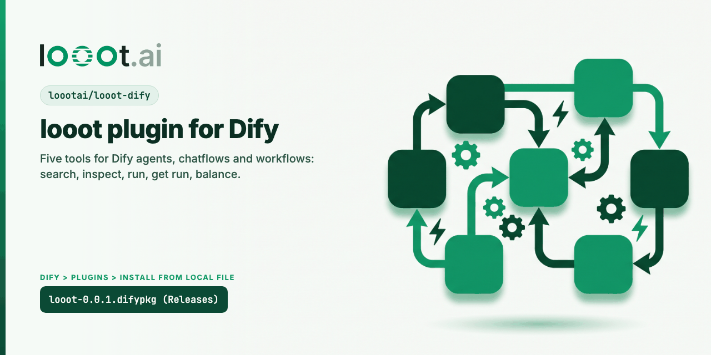

<p align="center"></p>

# looot for Dify

[](LICENSE) [](https://github.com/loootai/looot-dify/releases) [](https://docs.looot.ai)

looot gives an AI agent one key and one prepaid balance for 2,500+ data API endpoints from 90+ providers: work emails, phone numbers, company and people search, Google results, web pages, news, LinkedIn profiles and local businesses. The agent searches the catalog, sees the price before it runs, and pays per call. A failed call costs nothing. There is no subscription, and you can top up from $5.

## Install for agents

```bash
claude mcp add --transport http looot https://api.looot.ai/mcp
```

See also: [awesome-looot-use-cases](https://github.com/loootai/awesome-looot-use-cases) (copy-paste recipes) and [awesome-gtm](https://github.com/loootai/awesome-gtm) (open-source GTM tools).

This plugin adds five tools to Dify agents, chatflows and workflows.

| Tool | What it does | Cost |
| --- | --- | --- |
| Search catalog | Find endpoints and jobs by describing the task in plain words | Free |
| Inspect operation | Read the exact input fields, output and price of one endpoint or job | Free |
| Run operation | Run an endpoint or job (`job:people.email.find` style ids work) | Prepaid credit |
| Get run | Read a run's status, result and cost | Free |
| Get balance | Read available credit and the top-up link | Free |

## Setup

1. Create a looot account at https://looot.ai and top up the balance (from $5).
2. In the looot dashboard open Settings, Agent tokens, and create a token. Tick `catalog.read`, `runs.read`, `runs.execute` and `usage.read`.
3. In Dify, install the plugin, open Tools, pick looot, click Authorize, and paste the token as "Agent token". Dify checks it by calling the balance endpoint.

## Usage

A typical agent flow is Search catalog, then Inspect operation to get the exact field names, then Run operation with the input as a JSON string, for example:

```json
{"endpoint_id": "job:people.email.find", "input": "{\"fullName\": \"Ada Lovelace\", \"domain\": \"example.com\"}"}
```

Run operation waits up to 20 seconds by default. If the run is not done, it returns a run id and you read the result with Get run. Set an idempotency key if you retry: the same key with the same input never pays twice. Fallback (on by default) lets a job try the next provider when the first finds nothing; `Max cost` caps the whole route.

## Required APIs and credentials

- API: https://api.looot.ai (REST, HTTPS only). Docs: https://docs.looot.ai
- Credential: one looot agent token.
- Network: Dify must reach api.looot.ai on port 443.

## Source

This repository is the plugin source. The same files ship inside the `.difypkg` on the langgenius/dify-plugins marketplace listing (pull request https://github.com/langgenius/dify-plugins/pull/3242). The request shapes mirror the public n8n node, https://github.com/loootai/n8n-nodes-looot.

## Install without the marketplace

Download `looot-0.0.1.difypkg` from the Releases page, then in Dify open Plugins, Install plugin, Install from local package file.

## Build it yourself

```bash
dify plugin package ./ -o looot.difypkg
```

The release package was built with dify-plugin CLI v0.6.10. Runtime pins are in `requirements.txt` (`dify_plugin==0.9.1`, `requests==2.33.1`).

## Privacy and support

See PRIVACY.md and https://looot.ai/privacy. Support: https://looot.ai/contact.
